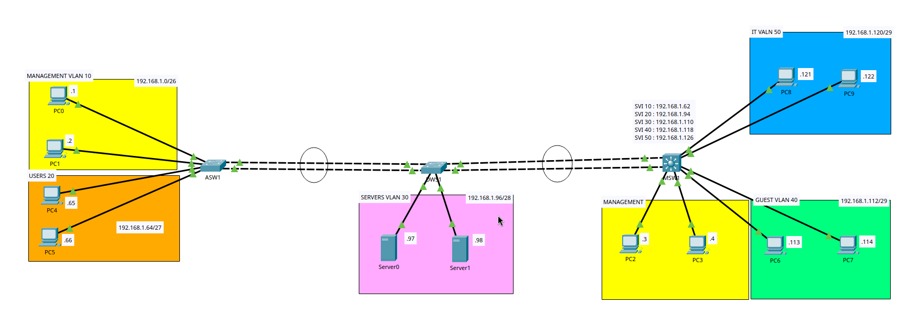

# MegaLab – Multi-VLAN Campus Network

## Overview

This MegaLab focuses on designing, configuring, and testing a segmented campus network using multiple switches, VLANs, Layer 2 EtherChannels, VTP, Rapid-PVST, and inter-VLAN routing.

The objective was to build a network with multiple departments and segments, implement redundancy between switches, configure VLAN-based segmentation, and provide connectivity between different networks using a multilayer switch.

## Topology



The network consists of three switches:
- **ASW1** – Access Switch
- **DSW1** – Distribution Switch
- **MSW1** – Multilayer Switch

The topology includes multiple end devices, servers, redundant switch links, and an EtherChannel-based inter-switch infrastructure.

## VLANs and IP Addressing

| VLAN | Name | Network | Gateway |
|---|---|---|---|
| VLAN 10 | Management | 192.168.1.0/26 | 192.168.1.62 |
| VLAN 20 | Users | 192.168.1.64/27 | 192.168.1.94 |
| VLAN 30 | Servers | 192.168.1.96/28 | 192.168.1.110 |
| VLAN 40 | Guest | 192.168.1.112/29 | 192.168.1.118 |
| VLAN 50 | IT | 192.168.1.120/29 | 192.168.1.126 |

## Technologies Implemented

- VLAN creation and segmentation
- IPv4 subnetting and VLSM
- Inter-VLAN routing
- VTP (VLAN Trunking Protocol)
- LACP EtherChannel
- 802.1Q trunking
- Native VLAN configuration
- Rapid-PVST (Rapid Spanning Tree)
- PortFast
- BPDU Guard
- Access-port configuration
- Switch security configuration
- End-to-end connectivity testing

## Cabling

| Connection | Cable | Why |
|---|---|---|
| PCs – Switches | Copper Straight-Through | Used to connect end devices to switch access ports. |
| Servers – Switches | Copper Straight-Through | Used to connect servers to the switching infrastructure. |
| Switch – Switch | Copper Cross-Over | Used to connect switches directly, forming the redundant links used for EtherChannel and trunking. |

## Switch Security

An `enable secret` password was configured on the switches to secure privileged EXEC mode.

```cisco
enable secret <password>
```

Cisco stores the `enable secret` using a cryptographic hash rather than storing the password in plaintext. In this lab, the configuration displays a Type 5 hash, which uses MD5-based hashing.

This provides better protection for the privileged EXEC password than the legacy `enable password` command.

## EtherChannel

Redundant links between switches were bundled using LACP to create logical Port-Channel interfaces.

This provides link redundancy and allows multiple physical links to operate as a single logical connection.

- **Port-channel1:** ASW1 – DSW1
- **Port-channel2:** DSW1 – MSW1

Trunk interfaces were configured with manually defined allowed VLANs and a dedicated native VLAN (1001).

## Spanning Tree

Rapid-PVST was configured across the switches to prevent Layer 2 loops while allowing faster convergence following topology changes.

Access ports were configured with:

- PortFast
- BPDU Guard

These configurations help protect the switching infrastructure against unexpected BPDU reception on endpoint-facing ports.

## Inter-VLAN Routing

MSW1 was configured as a multilayer switch with IP routing enabled.

SVIs were configured for VLANs 10, 20, 30, 40, and 50 to provide routing between the different network segments.

## Switch Credentials

A privileged EXEC password was configured on all switches to restrict access to privileged configuration and operational commands.

## Verification Commands

| Command | Purpose |
|---|---|
| `show running-config` | Displays the current active configuration. |
| `show startup-config` | Displays the saved configuration. |
| `show vlan brief` | Displays VLANs and their assigned ports. |
| `show interfaces trunk` | Displays trunk interfaces and their VLAN configuration. |
| `show etherchannel summary` | Verifies EtherChannel status and bundled ports. |
| `show spanning-tree` | Displays Spanning Tree information and port roles. |
| `show ip interface brief` | Displays interface and SVI IP addresses and their status. |
| `show interfaces switchport` | Displays switchport configuration and operational status. |
| `show vtp status` | Displays VTP configuration and status. |
| `show ip route` | Displays the routing table on the multilayer switch. |

## Lab Environment

- Cisco Packet Tracer
- Cisco IOS switch configurations
