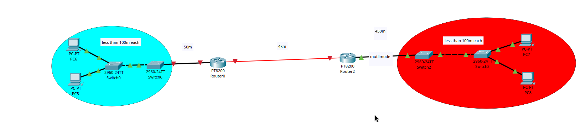
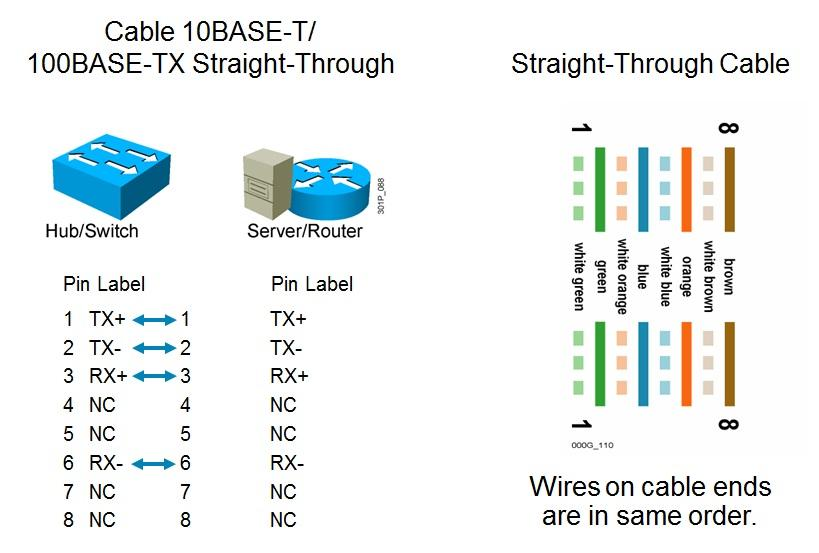
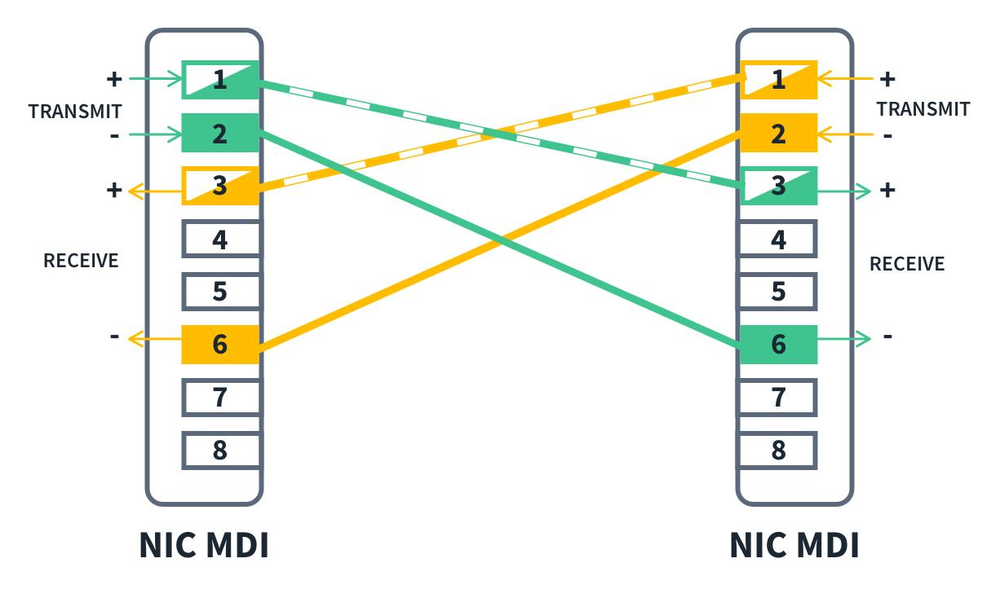

# Network Infrastructure Design – Cisco Packet Tracer

## Project Overview

A network infrastructure project developed using Cisco Packet Tracer, focusing on connecting two Local Area Networks (LANs) through routers over different transmission distances.

The project explores Ethernet cabling, fiber-optic transmission, cable selection, IEEE standards, and physical network connectivity.

## 1. Network Topology



## 2. Network Components

| Component | Quantity |
|---|---:|
| Routers | 2 |
| Switches | 4 |
| PCs | 4 |

## 3. Cable Selection and Justification

Cable selection depends on transmission distance, device compatibility, and network requirements.

| Connection | Distance | Cable Type | Justification |
|---|---:|---|---|
| PC – Switch | Less than 100 m | Copper Straight-through | Standard connection between end devices and switches. |
| Switch – Switch | Less than 100 m | Copper Crossover | Traditionally connects devices with the same MDI-X configuration. |
| Switch6 – Router0 | 50 m | Copper Straight-through | Suitable for Ethernet communication within the 100 m limit. |
| Router0 – Router2 | 4 km | Single-Mode Fiber | Supports long-distance communication with low signal attenuation. |
| Router2 – Switch2 | 450 m | Multimode Fiber | Suitable for medium-distance connections with compatible transceivers. |

## 4. Network Cabling & Ethernet Standards

Understanding Ethernet standards, transmission speeds, cable limitations, and pin configurations is essential when designing network infrastructure.

### 4.1 Copper Ethernet Standards

| Common Name | IEEE Standard | Ethernet Standard | Speed | Maximum Length |
|---|---|---|---|---|
| Ethernet | 802.3i | 10BASE-T | 10 Mbps | 100 m |
| Fast Ethernet | 802.3u | 100BASE-TX | 100 Mbps | 100 m |
| Gigabit Ethernet | 802.3ab | 1000BASE-T | 1 Gbps | 100 m |
| 10 Gigabit Ethernet | 802.3an | 10GBASE-T | 10 Gbps | 100 m* |

**Cable considerations:**

- 10BASE-T: Cat3 or better.
- 100BASE-TX: Cat5 or better.
- 1000BASE-T: Cat5e or better.
- 10GBASE-T: Cat6a recommended for 100 m.

*10GBASE-T over Cat6 may be limited to approximately 55 m.*

### 4.2 Fiber-Optic Ethernet Standards

Fiber-optic connections are suitable for higher bandwidth and longer transmission distances.

| Standard | IEEE Standard | Speed | Fiber Type | Maximum Length |
|---|---|---|---|---|
| 1000BASE-LX | 802.3z | 1 Gbps | Multimode / Single-mode | 550 m (MM) / 5 km (SM) |
| 10GBASE-SR | 802.3ae | 10 Gbps | Multimode | 400 m (OM4) |
| 10GBASE-LR | 802.3ae | 10 Gbps | Single-mode | 10 km |
| 10GBASE-ER | 802.3ae | 10 Gbps | Single-mode | 40 km |

**Fiber considerations:**

- **Multimode Fiber (MMF):** Uses a larger core and is generally used for shorter-distance connections, such as within buildings and campuses.
- **Single-mode Fiber (SMF):** Uses a smaller core and is designed for longer-distance transmission with lower attenuation.

The supported distance depends on the fiber grade, transceiver, and Ethernet standard.

### 4.3 Ethernet TX/RX Pin Configuration

Ethernet devices use different transmit (TX) and receive (RX) pin assignments.

| Device Type | Transmit (TX) Pins | Receive (RX) Pins |
|---|---|---|
| Router | 1 and 2 | 3 and 6 |
| Firewall | 1 and 2 | 3 and 6 |
| PC | 1 and 2 | 3 and 6 |
| Switch | 3 and 6 | 1 and 2 |

**Understanding MDI and MDI-X:**

- **MDI (Medium Dependent Interface):** Traditionally used by end devices such as PCs and routers.
- **MDI-X (Medium Dependent Interface Crossover):** Traditionally used by switches.

### 4.4 Straight-through Cable

A straight-through cable uses the same wiring standard on both ends (T568A–T568A or T568B–T568B).



**Pin Configuration:**

| Side A | Side B | Function |
|---|---|---|
| 1 | 1 | TX+ → RX+ |
| 2 | 2 | TX- → RX- |
| 3 | 3 | RX+ → TX+ |
| 6 | 6 | RX- → TX- |

**Common Applications:**
- PC ↔ Switch
- Router ↔ Switch
- Firewall ↔ Switch

### 4.5 Crossover Cable

A crossover cable uses different wiring standards on each end (T568A–T568B), crossing the transmit and receive pairs.



**Pin Configuration:**

| Side A | Side B | Function |
|---|---|---|
| 1 | 3 | TX+ → RX+ |
| 2 | 6 | TX- → RX- |
| 3 | 1 | RX+ → TX+ |
| 6 | 2 | RX- → TX- |

**Common Applications:**
- PC ↔ PC
- Switch ↔ Switch
- Router ↔ Router

**Important:** These traditional cable selection rules apply to MDI/MDI-X Ethernet interfaces. Modern devices commonly support Auto-MDI/MDIX, which automatically detects and adjusts transmit and receive pairs. Gigabit Ethernet also uses all four twisted pairs.

## 5. Implementation

1. Designed two separate LANs.
2. Connected end devices to access switches.
3. Connected switches to routers.
4. Established a 4 km connection between the two routers.
5. Selected copper and fiber-optic cables according to link distances.
6. Verified physical connectivity and interface status.

## 6. Verification

The following Cisco IOS commands can be used to inspect network interfaces:

**Check interface status:**

```bash
show ip interface brief
```

**Display interface details:**

```bash
show interfaces
```

**Verify connectivity:**

```bash
ping <destination-ip>
```

## 7. Technologies & Concepts

- Cisco Packet Tracer
- Local Area Networks (LAN)
- Wide Area Networks (WAN)
- Ethernet and Fast Ethernet
- Gigabit Ethernet
- Copper Ethernet cabling
- Fiber-optic transmission
- Single-mode and multimode fiber
- IEEE 802.3 standards
- MDI and MDI-X
- Straight-through and crossover cables
- Router interfaces and network connectivity

## 8. Project Objective

Gain practical experience in network infrastructure design, understand the differences between copper and fiber-optic transmission, explore Ethernet standards and wiring configurations, and learn how to select appropriate cabling for different network distances and requirements.
