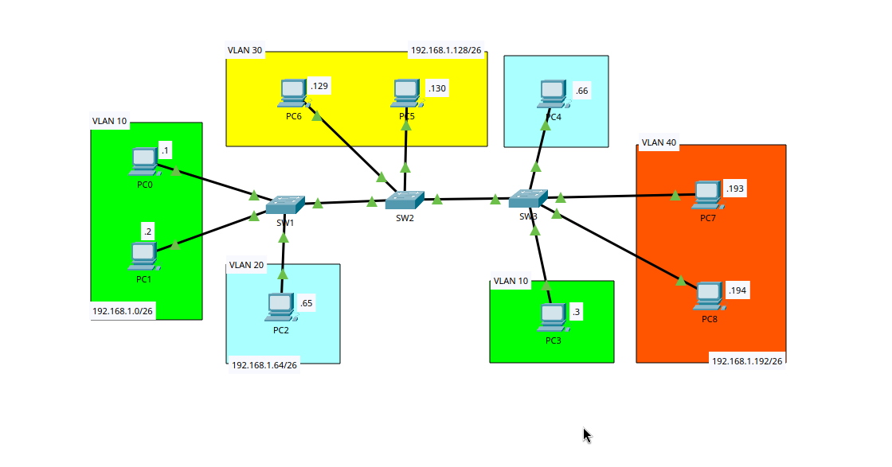

# Multi-Switch VLANs, VTP & DTP Configuration

## Overview

This project demonstrates VLAN segmentation and trunk configuration across multiple Cisco switches using Cisco Packet Tracer.

The network consists of three interconnected switches configured with VLANs, trunk links, and VTP in different operating modes.

Four VLANs are used to separate devices into different broadcast domains. Trunk links allow VLAN traffic to travel between switches, while VTP is used to demonstrate VLAN management and propagation.

## Network Topology



### Network Components

- 3 Layer 2 Switches
- 9 End Devices
- 4 VLANs
- Inter-switch trunk links
- VTP Server, Client and Transparent modes
- DTP configuration

## VLAN & IP Addressing

| VLAN | Network Address | Subnet Mask | CIDR |
|---|---|---|---|
| VLAN 10 | 192.168.1.0 | 255.255.255.192 | /26 |
| VLAN 20 | 192.168.1.64 | 255.255.255.192 | /26 |
| VLAN 30 | 192.168.1.128 | 255.255.255.192 | /26 |
| VLAN 40 | 192.168.1.192 | 255.255.255.192 | /26 |

Each subnet provides 62 usable IPv4 addresses.

## VLAN Distribution

| Switch | VLANs | Connected Devices |
|---|---|---|
| SW1 | 10, 20 | PC0, PC1, PC2 |
| SW2 | 30 | PC5, PC6 |
| SW3 | 10, 20, 40 | PC3, PC4, PC7, PC8 |

VLANs are distributed across multiple switches to demonstrate how VLAN traffic can be carried through trunk links.

## VLAN Configuration

The switches use the following VLANs:

| VLAN ID | Name |
|---|---|
| 10 | VLAN_10 |
| 20 | VLAN_20 |
| 30 | VLAN_30 |
| 40 | VLAN_40 |

### VLAN Creation

```cisco
vlan 10
 name VLAN_10

vlan 20
 name VLAN_20

vlan 30
 name VLAN_30

vlan 40
 name VLAN_40
```

## VTP Configuration

The switches use the VTP domain:

```text
SERVER_OX
```

| Switch | VTP Mode | Role |
|---|---|---|
| SW1 | Server | Central VLAN management |
| SW2 | Transparent | Local VLAN management |
| SW3 | Client | Receives VLAN information |

### SW1 – VTP Server

The server manages VLAN information and distributes VLAN database updates to VTP clients.

### SW2 – VTP Transparent

SW2 operates in transparent mode and maintains its own VLAN database independently of the VTP server.

VLAN 30 is configured locally on SW2, allowing the switch to use VLAN 30 without relying on VTP synchronization.

### SW3 – VTP Client

SW3 receives VLAN information from the VTP server and cannot independently create, modify, or delete VLANs in client mode.

## Trunk Configuration

Trunk links allow multiple VLANs to travel between switches.

| Link | Allowed VLANs | Native VLAN |
|---|---|---|
| SW1 – SW2 | 10, 20, 30 | 1001 |
| SW2 – SW3 | 10, 20, 30, 40 | 1001 |

Trunk ports use IEEE 802.1Q VLAN tagging.

### Trunk Configuration Commands

```cisco
switchport trunk native vlan 1001
switchport trunk allowed vlan 10,20,30,40
switchport mode trunk
switchport nonegotiate
```

The allowed VLAN list is configured according to the requirements of each trunk link.

## DTP – Dynamic Trunking Protocol

DTP is a Cisco protocol used to negotiate trunk links between switches.

### DTP Modes

| Mode | Description |
|---|---|
| Trunk | Forces the port to trunk mode |
| Access | Forces the port to access mode |
| Dynamic Desirable | Actively attempts to negotiate a trunk |
| Dynamic Auto | Passively waits for trunk negotiation |
| Nonegotiate | Disables DTP negotiation frames |

### DTP Compatibility

| Local Mode | Trunk | Access | Desirable | Auto |
|---|---|---|---|---|
| Trunk | TR | X | TR | TR |
| Access | X | ACC | ACC | ACC |
| Desirable | TR | ACC | TR | TR |
| Auto | TR | ACC | TR | ACC |

- **TR:** Trunk
- **ACC:** Access
- **X:** Mode mismatch

### Manual Trunk Configuration

In this lab, trunk links are manually configured instead of relying on DTP negotiation.

```cisco
switchport mode trunk
switchport nonegotiate
```

The `switchport nonegotiate` command disables DTP negotiation frames. Since trunking is manually configured, both ends of the link must be configured consistently.

## Key Networking Concepts

- **VLANs:** Separating devices into different broadcast domains.
- **Access Ports:** Connecting end devices to specific VLANs.
- **Trunk Ports:** Carrying traffic from multiple VLANs between switches.
- **IEEE 802.1Q:** Adding VLAN tags to Ethernet frames.
- **VTP:** Managing and distributing VLAN information between switches.
- **VTP Server:** Central VLAN database management.
- **VTP Client:** Receiving VLAN database updates.
- **VTP Transparent:** Maintaining a local VLAN database independently.
- **DTP:** Negotiating trunk links between Cisco switches.
- **Native VLAN:** Carrying untagged frames across trunk links.
- **IPv4 Subnetting:** Assigning separate IP networks to different VLANs.

## Verification & Troubleshooting

Useful Cisco IOS commands:

```cisco
show vlan brief
show vtp status
show interfaces trunk
show interfaces status
show running-config
```

These commands can be used to verify VLAN assignments, VTP operation, trunk configuration, and switch interfaces.

Connectivity can be tested using `ping` between PCs belonging to the same VLAN but connected to different switches.

## Learning Objectives

- Configure VLANs across multiple switches.
- Understand VTP Server, Client, and Transparent modes.
- Configure trunk links and allowed VLAN lists.
- Understand native VLAN configuration.
- Understand DTP trunk negotiation.
- Disable DTP negotiation using `switchport nonegotiate`.
- Analyze VLAN propagation across a switched network.
- Verify and troubleshoot VLAN and trunk configurations.