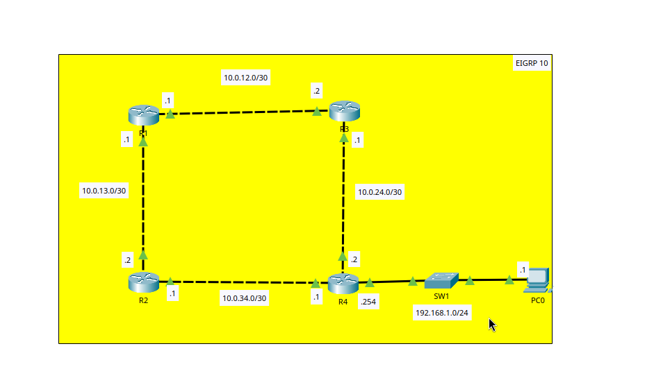

# Enhanced Interior Gateway Routing Protocol (EIGRP)

## Overview

This lab focuses on configuring and verifying **Enhanced Interior Gateway Routing Protocol (EIGRP)** in a multi-router topology.

The objective is to configure EIGRP between four routers, establish neighbor relationships, advertise networks, and verify routing information exchange and end-to-end connectivity.

## Topology

## Network Configuration

The topology consists of four routers (R1, R2, R3, and R4) connected through multiple point-to-point links, providing redundant paths between routers.

| Network | IP Addressing | Purpose |
|---|---|---|
| R1 – R3 | `10.0.12.0/30` | Point-to-point link |
| R1 – R2 | `10.0.13.0/30` | Point-to-point link |
| R3 – R4 | `10.0.24.0/30` | Point-to-point link |
| R2 – R4 | `10.0.34.0/30` | Point-to-point link |
| LAN | `192.168.1.0/24` | PC0 network |

Each router also has a loopback interface configured to represent an additional network.

## EIGRP Configuration

EIGRP was configured using Autonomous System number **10** on all routers.

The `network` command was used to advertise the connected networks and enable EIGRP on the corresponding interfaces.

Loopback interfaces were configured as passive interfaces to advertise their networks without forming neighbor relationships.

On R4, the interface connected to the LAN was also configured as passive to advertise the LAN network without sending EIGRP hello packets toward the LAN.

## Verification

The following commands were used to verify the EIGRP configuration and operation:

| Command | Purpose |
|---|---|
| `show ip protocols` | Verifies EIGRP configuration, advertised networks, passive interfaces and routing information sources |
| `show ip eigrp neighbors` | Displays EIGRP neighbor relationships |
| `show ip eigrp topology` | Displays the EIGRP topology table |
| `show ip route` | Verifies learned and installed routes |
| `ping` | Tests connectivity between devices |

## Key Concepts

- EIGRP Autonomous System numbers
- EIGRP neighbor discovery
- Network advertisement
- Passive interfaces
- EIGRP topology table
- Administrative Distance and metric
- Dynamic routing
- Redundant paths

## Conclusion

This lab helped reinforce the fundamentals of EIGRP configuration, neighbor discovery, network advertisement, routing table analysis, and dynamic routing in a multi-router topology.