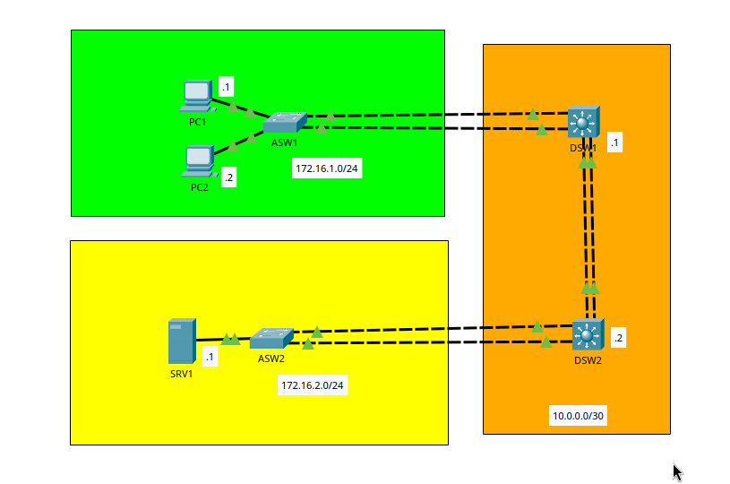

# EtherChannel & Layer 3 Switching

## Overview

This lab focuses on implementing and understanding **EtherChannel** and **Layer 3 switching** in a network consisting of two access switches and two multilayer distribution switches.

The objective is to combine multiple physical links into logical connections using different EtherChannel protocols, configure Layer 3 EtherChannel, and establish communication between different IP networks using static routing.

## Topology



The topology consists of four switches:

- **ASW1:** Access switch connected to PC1 and PC2.
- **ASW2:** Access switch connected to SRV1.
- **DSW1:** Multilayer distribution switch connected to ASW1.
- **DSW2:** Multilayer distribution switch connected to ASW2.

The two distribution switches are interconnected through a Layer 3 EtherChannel.

## IP Addressing

| Device | Interface | IP Address |
|---|---|---|
| PC1 | NIC | 172.16.1.1/24 |
| PC2 | NIC | 172.16.1.2/24 |
| ASW1 | VLAN 1 | Not configured |
| DSW1 | VLAN 1 SVI | 172.16.1.254/24 |
| SRV1 | NIC | 172.16.2.1/24 |
| DSW2 | VLAN 1 SVI | 172.16.2.254/24 |
| DSW1 | Port-channel2 | 10.0.0.1/30 |
| DSW2 | Port-channel2 | 10.0.0.2/30 |

### Default Gateways

- PC1: `172.16.1.254`
- PC2: `172.16.1.254`
- SRV1: `172.16.2.254`

## EtherChannel Configuration

Three EtherChannels were configured using different negotiation methods.

### 1. LACP – ASW1 to DSW1

| Switch | Interfaces | Configuration |
|---|---|---|
| ASW1 | Gi0/1 – Gi0/2 | Active |
| DSW1 | Gi1/0/3 – Gi1/0/4 | Active |

Both sides use **LACP Active mode**, allowing them to negotiate and establish the EtherChannel.

### 2. PAgP – ASW2 to DSW2

| Switch | Interfaces | Configuration |
|---|---|---|
| ASW2 | Gi0/1 – Gi0/2 | Desirable |
| DSW2 | Gi1/0/3 – Gi1/0/4 | Desirable |

Both sides use **PAgP Desirable mode**, actively negotiating the EtherChannel.

### 3. Static Layer 3 EtherChannel – DSW1 to DSW2

| Switch | Interfaces | Configuration |
|---|---|---|
| DSW1 | Gi1/0/1 – Gi1/0/2 | Mode On |
| DSW2 | Gi1/0/1 – Gi1/0/2 | Mode On |

Unlike the previous EtherChannels, this connection operates at Layer 3.

- Both physical interfaces are configured with `no switchport`.
- Both interfaces are assigned to channel-group 2.
- IP addresses are configured on the logical Port-channel2 interface.
- No LACP or PAgP negotiation is used.

## Layer 3 Switching & Routing

Both distribution switches operate as multilayer switches.

The following configurations are used:

- `ip routing` enables Layer 3 routing.
- VLAN 1 SVIs provide default gateways for the connected networks.
- Port-channel2 provides a routed connection between DSW1 and DSW2.
- Static routes allow communication between the two networks.

### Static Routing

**DSW1:**

```cisco
ip route 172.16.2.0 255.255.255.0 10.0.0.2
```

**DSW2:**

```cisco
ip route 172.16.1.0 255.255.255.0 10.0.0.1
```

## Spanning Tree Protocol

PVST+ is configured across the switches.

```cisco
spanning-tree mode pvst
```

The distribution switches have the following bridge priorities:

| Switch | VLAN | Priority |
|---|---|---|
| DSW1 | 1 | 24576 |
| DSW2 | 1 | 20480 |
| ASW1 | 1 | 32768 (Default) |
| ASW2 | 1 | 32768 (Default) |

The access switches have PortFast enabled on their end-device interfaces to allow faster transition to the forwarding state.

**Note:** The connection between DSW1 and DSW2 is a Layer 3 EtherChannel, so STP does not operate across that routed link.

## Verification Commands

The following commands were used to verify the configuration and operation of the network.

| Command | Purpose |
|---|---|
| `show etherchannel summary` | Verify EtherChannel status and bundled interfaces |
| `show interfaces trunk` | Verify trunk interfaces |
| `show spanning-tree vlan 1` | Inspect STP information |
| `show ip interface brief` | Verify interface status and IP addressing |
| `show ip route` | Inspect the routing table |
| `show running-config` | Review device configurations |

### EtherChannel Expected Results

| Connection | Expected Status |
|---|---|
| ASW1 – DSW1 | Po1(SU) – LACP |
| ASW2 – DSW2 | Po1(SU) – PAgP |
| DSW1 – DSW2 | Po2(RU) – Static Layer 3 |

## Connectivity Testing

Connectivity was tested between devices located in different networks.

Examples:

```text
PC1 → 172.16.1.254
PC1 → 172.16.2.254
PC1 → SRV1 (172.16.2.1)
SRV1 → PC1 (172.16.1.1)
```

Successful communication verifies the Layer 3 connectivity between the two subnets.

## Key Concepts Practiced

- EtherChannel configuration and verification.
- LACP and PAgP negotiation.
- Static EtherChannel using `mode on`.
- Layer 2 and Layer 3 Port-channels.
- 802.1Q trunking.
- Multilayer switching.
- VLAN 1 SVI configuration.
- PVST+ and STP bridge priorities.
- Static routing between different subnets.
- Network connectivity troubleshooting.