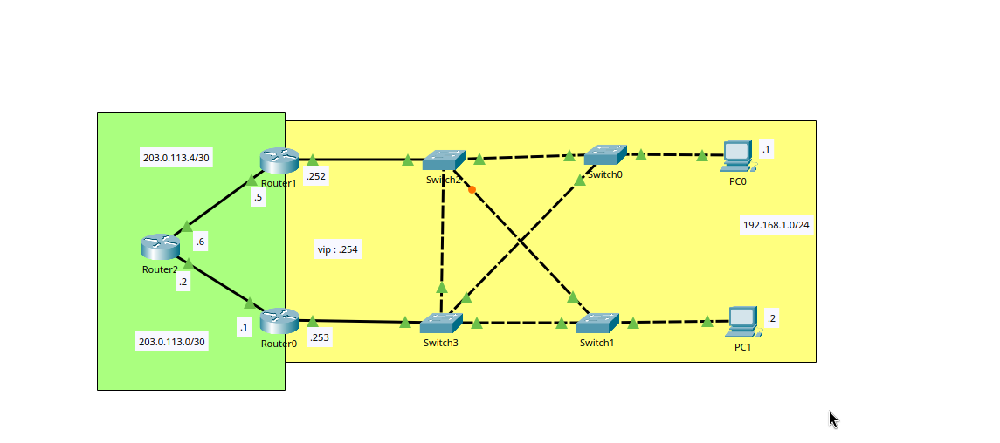

# HSRP + OSPF Redundancy Lab

A network lab combining HSRP, OSPF, redundant Layer 2 paths and upstream connectivity. The goal is to provide gateway redundancy for the LAN and test failover and end-to-end connectivity.

## Topology



## Overview

- **HSRP:** Provides a redundant default gateway for the LAN.
- **OSPF:** Advertises the LAN and upstream networks to provide routing.
- **Passive Interfaces:** Advertise LAN networks without forming OSPF adjacencies with hosts.
- **Static Default Routes:** R1 and R2 use R3 as their upstream next hop.
- **STP:** Prevents Layer 2 loops across redundant switch links.
- **PortFast & BPDU Guard:** Protect host-facing ports and speed up host connectivity.
- **Failover Testing:** Test gateway redundancy and end-to-end connectivity during failures.

## IP Addressing

| Device | Interface | IP Address |
|---|---|---|
| R1 | G0/0 | 192.168.1.252/24 |
| R2 | G0/0 | 192.168.1.253/24 |
| R1 | G0/1 | 203.0.113.5/30 |
| R2 | G0/1 | 203.0.113.1/30 |
| R3 | G0/0 | 203.0.113.2/30 |
| R3 | G0/1 | 203.0.113.6/30 |
| R3 | Loopback0 | 8.8.8.8/32 |
| HSRP | Virtual IP | 192.168.1.254 |
| PC0 | NIC | 192.168.1.1/24 |
| PC1 | NIC | 192.168.1.2/24 |

## HSRP Configuration

HSRP version 2 is configured on R1 and R2 to provide a virtual default gateway for the LAN.

| Router | IP Address | Priority | Role |
|---|---|---:|---|
| R1 | 192.168.1.252 | 100 | Standby |
| R2 | 192.168.1.253 | 200 | Preferred Active |
| Virtual IP | 192.168.1.254 | — | Default Gateway |

R2 has a higher HSRP priority and is intended to be the Active router. Preemption is enabled on both routers, allowing R2 to reclaim the Active role after recovery.

### HSRP Commands

```cisco
standby version 2
standby 1 ip 192.168.1.254
standby 1 preempt
```

On R2:

```cisco
standby 1 priority 200
```

## OSPF Configuration

OSPF process 1 is configured in Area 0.

- R1 advertises its upstream network and LAN.
- R2 advertises its upstream network and LAN.
- R3 advertises both upstream networks and its Loopback0.
- LAN interfaces on R1 and R2 are configured as passive interfaces.

### Passive Interfaces

Passive interfaces allow the LAN subnet to be advertised through OSPF without sending OSPF hello packets or forming adjacencies on the LAN interface.

```cisco
router ospf 1
 passive-interface GigabitEthernet0/0
```

## Routing

R1 and R2 use static default routes pointing toward R3.

### R1

```cisco
ip route 0.0.0.0 0.0.0.0 203.0.113.6
```

### R2

```cisco
ip route 0.0.0.0 0.0.0.0 203.0.113.2
```

R3 has an OSPF cost of 10000 configured on G0/0 to influence path selection.

## Spanning Tree

The switches have redundant Layer 2 connections. Spanning Tree is used to prevent loops while allowing redundant paths to remain available.

## PortFast & BPDU Guard

PortFast is configured on host-facing ports to allow them to transition directly to the forwarding state without waiting through the normal STP listening and learning stages.

BPDU Guard is enabled on host-facing ports to protect the network from unexpected BPDU frames. If a BPDU is received on a BPDU Guard-enabled port, the port is placed into err-disabled state.

### Configuration

```cisco
interface range fa0/1-2
 spanning-tree portfast
 spanning-tree bpduguard enable
```

These features are intended for end-device ports, not switch-to-switch trunk links.

## Cable Connections

| Connection | Purpose |
|---|---|
| R1 – R3 | Upstream routing connection |
| R2 – R3 | Upstream routing connection |
| R1 – Switch2 | LAN connectivity |
| R2 – Switch3 | LAN connectivity |
| Switch2 – Switch0 | Layer 2 connectivity |
| Switch3 – Switch1 | Layer 2 connectivity |
| Switch2 – Switch1 | Redundant Layer 2 path |
| Switch3 – Switch0 | Redundant Layer 2 path |
| Switch2 – Switch3 | Inter-switch connectivity |
| Switch0 – Switch1 | Inter-switch connectivity |
| Switch0 – PC0 | Host connection |
| Switch1 – PC1 | Host connection |

## Key Commands

### HSRP

```cisco
show standby brief
show standby g0/0
```

### OSPF

```cisco
show ip ospf neighbor
show ip protocols
show ip route ospf
```

### Routing

```cisco
show ip route
show ip interface brief
ping 8.8.8.8
```

### Spanning Tree

```cisco
show spanning-tree
show spanning-tree vlan 1
```

### PortFast & BPDU Guard

```cisco
show running-config
show spanning-tree interface fa0/1 detail
```

## Failover Testing

1. Verify that R2 is the Active HSRP router.
2. Ping the virtual gateway `192.168.1.254` from the PCs.
3. Ping `8.8.8.8` to verify end-to-end connectivity.
4. Shut down R2's G0/0 interface.
5. Verify that R1 becomes Active.
6. Test connectivity again.
7. Restore R2's G0/0 interface.
8. Verify that R2 reclaims the Active role due to its higher priority and preemption.

## Key Concepts

- HSRP Version 2
- HSRP Priority & Preemption
- OSPF Area 0
- Passive Interfaces
- Static Default Routing
- Spanning Tree Protocol
- PortFast
- BPDU Guard
- Layer 2 Redundancy
- Gateway Failover
- End-to-End Connectivity
- Network Troubleshooting
