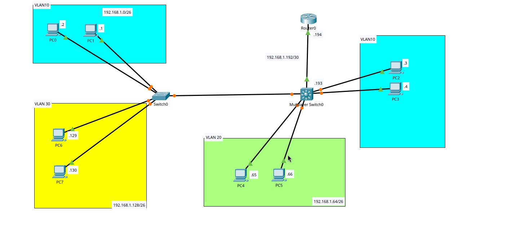

# VLAN Trunking & Inter-VLAN Routing

## Lab Topology

## Description

This lab focuses on VLAN segmentation, trunking between switches, and inter-VLAN routing configuration using Cisco Packet Tracer.

## VLANs & IP Addressing

| VLAN | Network | Subnet Mask |
|---|---|---|
| VLAN 10 | 192.168.1.0/26 | 255.255.255.192 |
| VLAN 20 | 192.168.1.64/26 | 255.255.255.192 |
| VLAN 30 | 192.168.1.128/26 | 255.255.255.192 |

## Switch Configuration

### Switch0 (SW0)

| Interface | Configuration |
|---|---|
| Fa0/1 - Fa0/2 | Access VLAN 10 |
| Fa0/3 - Fa0/4 | Access VLAN 30 |
| Fa0/5 | Trunk |

Trunk configuration:
- Native VLAN: 1001
- Allowed VLANs: 10, 30
- Encapsulation: IEEE 802.1Q

### Multilayer Switch (MS0)

| Interface | Configuration |
|---|---|
| Gi1/0/1 | Trunk |
| Gi1/0/3 | Access VLAN 10 |
| Gi1/0/5 | Access VLAN 10 |
| Gi1/0/7 - Gi1/0/8 | Access VLAN 20 |
| Gi1/0/10 | Routed Port |

Trunk configuration:
- Native VLAN: 1001
- Allowed VLANs: 10, 30

Routed interface:
- IP Address: 192.168.1.193/30

## Router Configuration (R0)

Router subinterfaces configured using IEEE 802.1Q:

| Subinterface | VLAN | IP Address |
|---|---|---|
| Gi0/0.10 | 10 | 192.168.1.62/26 |
| Gi0/0.20 | 20 | 192.168.1.126/26 |
| Gi0/0.30 | 30 | 192.168.1.190/26 |

A default route is also configured:

`ip route 0.0.0.0 0.0.0.0 203.0.113.1`

## Objectives

- Create and configure multiple VLANs.
- Assign switch ports to their respective VLANs.
- Configure 802.1Q trunk links.
- Configure native and allowed VLANs.
- Configure router subinterfaces for inter-VLAN routing.
- Configure a routed interface between network devices.
- Understand network segmentation and communication between VLANs.

## Verification Commands

- `show vlan brief`
- `show interfaces trunk`
- `show interfaces switchport`
- `show ip interface brief`
- `show ip route`
- `ping`

