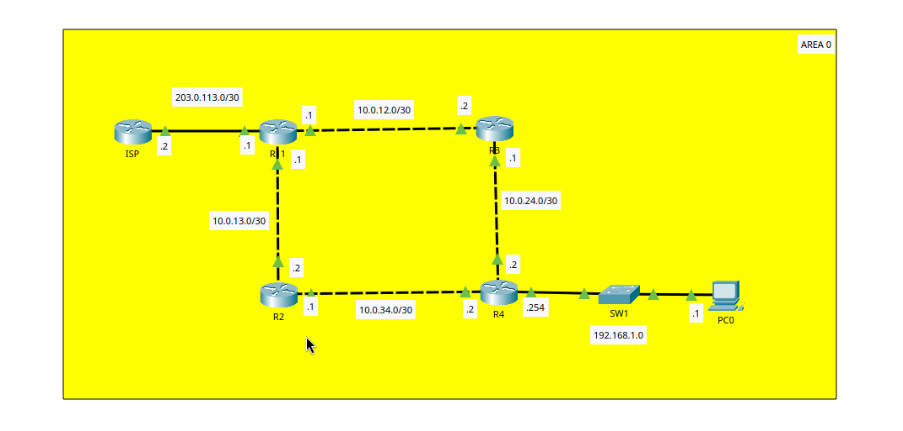

# OSPF (Open Shortest Path First)

## Overview

This lab focuses on configuring **OSPF (Open Shortest Path First)** across multiple routers within a single Area (Area 0).

The objective is to establish OSPF adjacencies, advertise networks, learn routes dynamically, propagate a default route throughout the OSPF domain, and adjust OSPF cost calculation using a custom reference bandwidth.

## Topology



## IP Addressing

| Device | Interface | IP Address | Network |
|---|---|---|---|
| R1 | G0/0 | 10.0.13.1/30 | 10.0.13.0/30 |
| R1 | G0/1 | 10.0.12.1/30 | 10.0.12.0/30 |
| R1 | G0/2 | 203.0.113.1/30 | 203.0.113.0/30 |
| R1 | Loopback0 | 1.1.1.1/32 | - |
| R2 | G0/0 | 10.0.34.1/30 | 10.0.34.0/30 |
| R2 | G0/1 | 10.0.13.2/30 | 10.0.13.0/30 |
| R2 | Loopback0 | 2.2.2.2/32 | - |
| R3 | G0/0 | 10.0.12.2/30 | 10.0.12.0/30 |
| R3 | G0/1 | 10.0.24.1/30 | 10.0.24.0/30 |
| R3 | Loopback0 | 3.3.3.3/32 | - |
| R4 | G0/0 | 10.0.34.2/30 | 10.0.34.0/30 |
| R4 | G0/1 | 10.0.24.2/30 | 10.0.24.0/30 |
| R4 | G0/2 | 192.168.1.254/24 | 192.168.1.0/24 |
| R4 | Loopback0 | 4.4.4.4/32 | - |
| PC0 | NIC | 192.168.1.1/24 | 192.168.1.0/24 |

## OSPF Configuration

All internal routers are configured to use **OSPF Process 1** in **Area 0**.

### R1

- Advertised the 10.0.13.0/30 and 10.0.12.0/30 networks.
- Advertised Loopback0 (1.1.1.1/32).
- Configured Loopback0 as a passive interface.
- Configured a static default route toward the ISP.
- Configured OSPF default route propagation using `default-information originate`.
- Adjusted OSPF cost calculation using a reference bandwidth of 10,000 Mbps.

### R2

- Advertised the 10.0.13.0/30 and 10.0.34.0/30 networks.
- Advertised Loopback0 (2.2.2.2/32).
- Configured Loopback0 as a passive interface.
- Adjusted OSPF cost calculation using a reference bandwidth of 10,000 Mbps.

### R3

- Advertised the 10.0.12.0/30 and 10.0.24.0/30 networks.
- Advertised Loopback0 (3.3.3.3/32).
- Configured Loopback0 as a passive interface.
- Adjusted OSPF cost calculation using a reference bandwidth of 10,000 Mbps.

### R4

- Advertised the 10.0.24.0/30 and 10.0.34.0/30 networks.
- Advertised the 192.168.1.0/24 LAN.
- Advertised Loopback0 (4.4.4.4/32).
- Configured G0/2 and Loopback0 as passive interfaces.
- Adjusted OSPF cost calculation using a reference bandwidth of 10,000 Mbps.

## OSPF Reference Bandwidth

Configured the following command on all routers under the OSPF process:

```cisco
router ospf 1
 auto-cost reference-bandwidth 10000
```

The `auto-cost reference-bandwidth` command changes the reference bandwidth used by OSPF to calculate interface costs.

By default, Cisco OSPF uses a reference bandwidth of 100 Mbps. Increasing it to 10,000 Mbps (10 Gbps) allows OSPF to assign more meaningful costs to higher-speed interfaces.

OSPF calculates interface cost using the following formula:

\[
\text{OSPF Cost} = \frac{\text{Reference Bandwidth}}{\text{Interface Bandwidth}}
\]

Using a higher reference bandwidth helps differentiate interface costs on modern networks instead of allowing multiple high-speed interfaces to have the same default cost.

## Default Route Propagation

R1 is configured with a static default route pointing toward the ISP:

```cisco
ip route 0.0.0.0 0.0.0.0 203.0.113.2
```

The following command is used to advertise the default route through OSPF:

```cisco
router ospf 1
 default-information originate
```

This allows the other routers in the OSPF domain to dynamically learn a default route through R1.

## Passive Interfaces

Passive interfaces are configured to prevent OSPF neighbor formation on interfaces where it is unnecessary, while still advertising their connected networks.

- **R1:** Loopback0
- **R2:** Loopback0
- **R3:** Loopback0
- **R4:** G0/2 and Loopback0

## Switch Configuration

SW1 was configured with PortFast and BPDU Guard on its access ports.

```cisco
interface FastEthernet0/1
 spanning-tree portfast
 spanning-tree bpduguard enable

interface FastEthernet0/2
 spanning-tree portfast
 spanning-tree bpduguard enable
```

- **PortFast:** Allows access ports to transition quickly to the forwarding state.
- **BPDU Guard:** Disables a PortFast-enabled port if it receives a BPDU, helping protect against potential Layer 2 loops.

## Verification Commands

The following commands can be used to verify OSPF operation, adjacencies, routing, and interface costs:

```cisco
show ip ospf neighbor
show ip route
show ip route ospf
show ip protocols
show ip ospf database
show ip ospf interface
show ip interface brief
```

## Key Concepts Practiced

- OSPF configuration
- OSPF neighbor formation
- OSPF Area 0
- Dynamic route advertisement
- Passive interfaces
- Loopback advertisement
- OSPF routing table
- OSPF interface cost
- Reference bandwidth
- Static default route
- Default route propagation
- PortFast
- BPDU Guard
