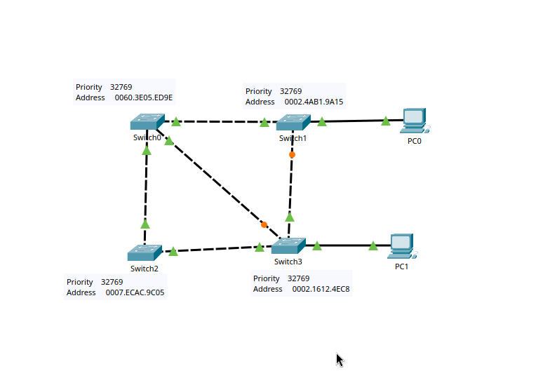

# Per-VLAN Spanning Tree Plus (PVST+)

## Network Topology




## Overview

This lab focuses on understanding and configuring **Per-VLAN Spanning Tree Plus (PVST+)** in a switched network containing four interconnected switches.

The objective is to understand how PVST+ prevents Layer 2 loops by electing Root Bridges, selecting port roles, and blocking redundant links.

It also covers STP protection mechanisms such as PortFast, BPDU Guard, BPDU Filter, Root Guard, and Loop Guard.

## Topology

The topology consists of four interconnected switches with redundant links and two end devices.

- Switch0
- Switch1
- Switch2
- Switch3
- PC0
- PC1

## PVST+ Configuration

PVST+ maintains a separate Spanning Tree instance for each VLAN, allowing different Root Bridges and forwarding paths.

```cisco
spanning-tree mode pvst
spanning-tree extend system-id
```

### Root Bridge Election

Different priorities were configured to elect different Root Bridges for each VLAN.

| Switch | VLAN 1 Priority | VLAN 2 Priority |
|---|---:|---:|
| Switch0 | 28672 | 24576 |
| Switch1 | 32768 | 32768 |
| Switch2 | 24576 | 28672 |
| Switch3 | 32768 | 32768 |

### Expected Root Bridges

| VLAN | Root Bridge | Priority |
|---|---|---:|
| VLAN 1 | Switch2 | 24576 |
| VLAN 2 | Switch0 | 24576 |

### Switch0

```cisco
spanning-tree vlan 2 priority 24576
spanning-tree vlan 1 priority 28672
```

### Switch2

```cisco
spanning-tree vlan 1 priority 24576
spanning-tree vlan 2 priority 28672
```

## STP Security Features

### 1. PortFast

Allows access ports connected to end devices to transition directly to the forwarding state without waiting for the normal STP listening and learning stages.

```cisco
interface FastEthernet0/3
 spanning-tree portfast
```

### 2. BPDU Guard

Disables a PortFast-enabled interface if it receives a BPDU, protecting the network against unauthorized switches.

**Interface configuration:**

```cisco
interface FastEthernet0/3
 spanning-tree bpduguard enable
```

**Global configuration:**

```cisco
spanning-tree portfast bpduguard default
```

### 3. BPDU Filter

Prevents BPDU transmission and reception on an interface.

**Interface configuration:**

```cisco
interface FastEthernet0/3
 spanning-tree bpdufilter enable
```

**Global configuration:**

```cisco
spanning-tree portfast bpdufilter default
```

The global configuration disables BPDU filtering if a BPDU is received, allowing normal STP operation to resume.

### 4. Root Guard

Prevents another switch from becoming the Root Bridge through a specific interface.

If a superior BPDU is received, the interface enters a root-inconsistent state.

```cisco
interface FastEthernet0/1
 spanning-tree guard root
```

### 5. Loop Guard

Prevents an STP-enabled port from transitioning into the forwarding state when BPDUs unexpectedly stop arriving.

This helps prevent Layer 2 loops caused by unidirectional link failures.

**Interface configuration:**

```cisco
interface FastEthernet0/1
 spanning-tree guard loop
```

**Global configuration:**

```cisco
spanning-tree loopguard default
```

## STP Protection Comparison

| Feature | Purpose |
|---|---|
| PortFast | Direct transition to forwarding |
| BPDU Guard | Protects access ports against unexpected BPDUs |
| BPDU Filter | Suppresses BPDU transmission and reception |
| Root Guard | Prevents unauthorized Root Bridge election |
| Loop Guard | Prevents loops caused by missing BPDUs |


## What I Practiced

- Configuring PVST+ on multiple switches.
- Electing different Root Bridges for different VLANs.
- Understanding STP port roles and redundant links.
- Understanding how STP prevents Layer 2 loops.
- Configuring PortFast and BPDU Guard.
- Understanding BPDU Filter, Root Guard, and Loop Guard.
- Learning how STP protection mechanisms improve network stability and security.