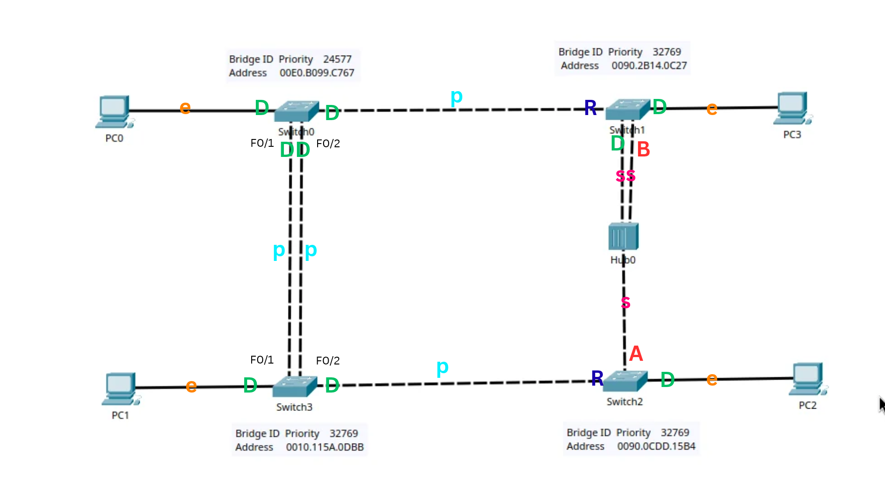

# Rapid Spanning Tree Protocol (RSTP)

## Overview

This lab focuses on understanding **Rapid Spanning Tree Protocol (RSTP)** and how it improves convergence time compared to traditional STP.

The objective is to analyze port roles, port states, port types, path costs, and how RSTP handles redundant links while preventing Layer 2 loops.

## Topology

The topology consists of four interconnected switches with redundant connections, end hosts, and a hub to demonstrate different RSTP port roles and port types.



## Port Roles

RSTP introduces additional port roles to improve convergence and handle redundant links efficiently.

| Port Role | Symbol | Description |
|---|---|---|
| Root Port | R | The port providing the best path toward the Root Bridge. |
| Designated Port | D | The port responsible for forwarding frames toward a connected segment. |
| Alternate Port | A | A backup path to the Root Bridge that can quickly transition to forwarding if the Root Port fails. |
| Backup Port | B | A backup for another Designated Port on the same shared segment. |

## Port Types

RSTP classifies ports based on the type of connection.

| Port Type | Symbol | Description |
|---|---|---|
| Edge | E | A port connected to an end device, such as a PC. |
| Point-to-Point | P | A port connected to another switch through a full-duplex link. |
| Shared | S | A port connected through a shared medium, typically half-duplex. |

## RSTP Port States

RSTP simplifies the traditional STP port states into three states.

| State | Description |
|---|---|
| Discarding | The port does not forward frames or learn MAC addresses. |
| Learning | The port learns MAC addresses but does not forward frames. |
| Forwarding | The port forwards frames and learns MAC addresses. |

Alternate and Backup ports normally remain in the Discarding state until needed.

## RSTP Path Cost

RSTP uses path cost to determine the best path toward the Root Bridge.

| Bandwidth | Path Cost |
|---|---:|
| 10 Mbps | 2,000,000 |
| 100 Mbps | 200,000 |
| 1 Gbps | 20,000 |
| 10 Gbps | 2,000 |
| 100 Gbps | 200 |
| 1 Tbps | 20 |

Lower path costs are preferred when determining the best path toward the Root Bridge.

## PortFast

PortFast is configured on ports connected to end devices to allow them to transition quickly to the forwarding state without waiting for the traditional STP listening and learning delays.

### Configuration

```cisco
Switch(config)# interface FastEthernet0/1
Switch(config-if)# spanning-tree portfast
```

PortFast should normally be used on end-device ports, not on connections to other switches.

## STP Enhancements

The following features were introduced as enhancements to traditional STP to improve convergence.

| Feature | Description |
|---|---|
| UplinkFast | Helps access switches quickly transition to an alternate uplink after a failure. |
| BackboneFast | Helps detect indirect link failures and accelerate convergence by bypassing the traditional Max Age wait. |

RSTP provides these rapid convergence mechanisms natively, making UplinkFast and BackboneFast legacy STP enhancements rather than features that are normally required with RSTP.

## Technologies

- Spanning Tree Protocol (STP)
- Rapid Spanning Tree Protocol (RSTP)
- Rapid PVST+
- Root Bridge election
- Root Ports, Designated Ports, Alternate Ports, Backup Ports
- Port States
- Port Types
- Path Cost
- PortFast
- UplinkFast
- BackboneFast

## Lab Objectives

- Analyze RSTP port roles and port states.
- Understand Alternate and Backup port behavior.
- Understand Edge, Point-to-Point and Shared port types.
- Analyze path cost and its effect on path selection.
- Understand rapid convergence and redundancy.
- Explore PortFast and legacy STP convergence enhancements.