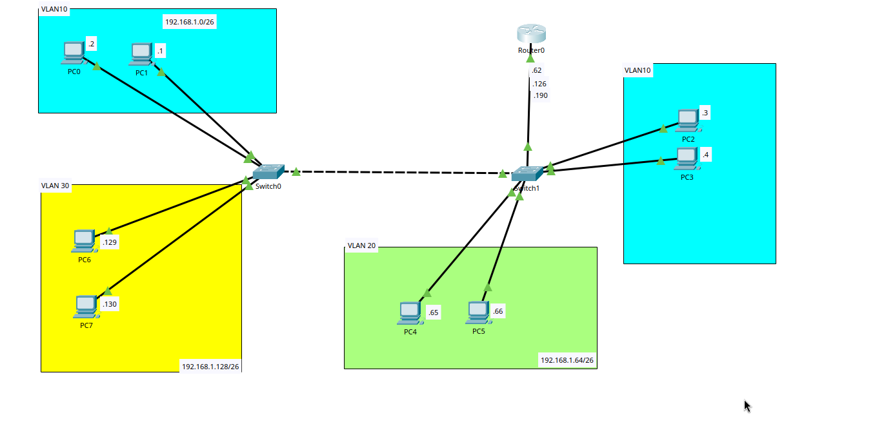

# VLAN Configuration – Router-on-a-Stick

## Overview

This project demonstrates VLAN segmentation and inter-VLAN routing using Cisco Packet Tracer.

The network consists of two interconnected switches and one router. Devices are divided into three VLANs, each assigned a separate IPv4 subnet.

The switches communicate through a trunk link, while the router uses **Router-on-a-Stick** with IEEE 802.1Q encapsulation to enable communication between VLANs.

## Network Topology



### Network Components

- 1 Router
- 2 Layer 2 Switches
- 3 VLANs each has 2 pcs
- 2 Trunk Connections

## VLAN & IP Addressing

| VLAN | Network Address | Subnet Mask | Default Gateway |
|---|---|---|---|
| VLAN 10 | 192.168.1.0/26 | 255.255.255.192 | 192.168.1.62 |
| VLAN 20 | 192.168.1.64/26 | 255.255.255.192 | 192.168.1.126 |
| VLAN 30 | 192.168.1.128/26 | 255.255.255.192 | 192.168.1.190 |

## Switch Configuration

### SW0

| Interface | Mode | VLAN |
|---|---|---|
| Fa0/1 – Fa0/2 | Access | 10 |
| Fa0/3 – Fa0/4 | Access | 30 |
| Fa0/5 | Trunk | 10, 30 |

### SW1

| Interface | Mode | VLAN |
|---|---|---|
| Fa0/1 – Fa0/2 | Access | 10 |
| Fa0/3 – Fa0/4 | Access | 20 |
| Fa0/5 | Trunk | 10, 30 |
| Fa0/6 | Trunk | 10, 20, 30 |

### VLAN Creation

```cisco
vlan 10
vlan 20
vlan 30
```

### Trunk Configuration

The inter-switch trunk carries VLANs 10 and 30.

The router-facing trunk carries VLANs 10, 20 and 30.

```cisco
switchport trunk native vlan 1001
switchport trunk allowed vlan 10,20,30
switchport mode trunk
```

The allowed VLAN list should be configured according to each trunk's requirements.

## Router Configuration

Router-on-a-Stick is implemented using three subinterfaces on GigabitEthernet0/0.

Each subinterface is associated with a VLAN using IEEE 802.1Q encapsulation.

```cisco
interface GigabitEthernet0/0
 no ip address
 no shutdown

interface GigabitEthernet0/0.10
 encapsulation dot1Q 10
 ip address 192.168.1.62 255.255.255.192

interface GigabitEthernet0/0.20
 encapsulation dot1Q 20
 ip address 192.168.1.126 255.255.255.192

interface GigabitEthernet0/0.30
 encapsulation dot1Q 30
 ip address 192.168.1.190 255.255.255.192
```

## Key Networking Concepts

- **VLANs:** Dividing a network into separate broadcast domains.
- **Access Ports:** Assigning end devices to specific VLANs.
- **Trunk Ports:** Carrying traffic from multiple VLANs between network devices.
- **IEEE 802.1Q:** Adding VLAN tags to Ethernet frames.
- **Router-on-a-Stick:** Using one physical router interface with multiple subinterfaces for inter-VLAN routing.
- **Native VLAN:** Identifying untagged traffic on a trunk connection.

## Verification & Troubleshooting

Useful Cisco IOS commands:

```cisco
show vlan brief
show interfaces trunk
show interfaces status
show ip interface brief
show ip route
show running-config
copy running-config startup-config
```

Connectivity can be tested using `ping` between PCs belonging to different VLANs.


## Learning Objectives

- Configure VLANs on multiple switches.
- Assign access ports to VLANs.
- Configure trunk links between switches.
- Understand IEEE 802.1Q encapsulation.
- Configure router subinterfaces.
- Implement inter-VLAN routing.
- Verify and troubleshoot network connectivity.